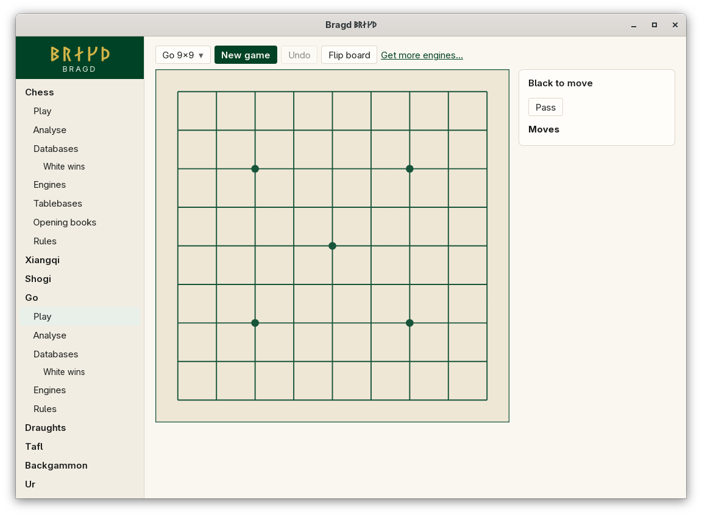

[← README](../../README.md) · [Docs index](../README.md) · [Play](README.md)

# Go

Go on three boards, under Chinese rules: area scoring with a komi of 7.5. Black plays first. You place a stone on an empty point; a chain with no liberties is taken off. Two passes in a row end the play, and then both Sides agree which stones are dead before the score is counted.

*Go 9×9.*

*Go 19×19.*

| Variant | Key | Board |
|---|---|---|
| Go 9×9 | `go-9` | 9×9 |
| Go 13×13 | `go-13` | 13×13 |
| Go 19×19 | `go-19` | 19×19 |

## How to reach it

Sidebar → **Go** → **Play**, then choose the board size in the first list of the bar.

## What it needs

Nothing to play against yourself. Against an Engine: KataGo or GNU Go installed, spoken to in GTP ([Playing against an Engine](against-an-engine.md)).

## Controls

| What you want | What you do |
|---|---|
| Place a stone | Click an empty point. Only legal points take a stone: a ko point or a suicide does nothing |
| Pass | **Pass**, under the turn line |
| End the play | Both Sides pass in a row. The scoring step starts |
| Mark dead stones | In the scoring step, click each stone both Sides agree is dead. Click it again to unmark it. Stones are marked one at a time; there is no group selection yet |
| Propose the dead stones | **Propose these dead stones** sends the whole set you marked. With none marked, it proposes that no stone is dead |
| Agree | The other Side presses **Accept the score**. The Game ends and the banner shows the result, such as `B+3.5` or `W+R` |
| Disagree | **Resume play** goes back to playing. The turn stands as it was |

Board colours: [Board themes](../look/board-themes.md).

## Settings and config.toml

| Setting | `config.toml` key | Default | What it does |
|---|---|---|---|
| The Family on or off | `families.family` | On | `go = false` under `[families.family]` hides it |
| A board size on or off | `families.variant` | All on | `go-13 = false` under `[families.variant]` hides 13×13 |
| Default Engine | `engines.default` | First installed | Such as `go-19 = "katago"` |

## Questions

#### Why do two passes not end the Game?

Under Go's rules the players must agree which stones are dead before the score counts. Two passes start that step. The record keeps the proposal and the agreement, so the Game replays to the same result.

#### What if we cannot agree?

Press **Resume play** and play it out. Under area scoring, playing in your own territory costs nothing, so settling a dispute on the board is free.

#### Why is komi 7.5 on the 9×9 board too?

The komi does not change with the board size. 7.5 is the standard figure for 19×19 under area scoring; 9×9 is often played with less. This is a simplification, named on the [Go](../rules/go.md) rules page.

#### Can I play with handicap stones?

Not yet. The rules crate has the placements and the komi they need, but New game does not offer them.

#### Can an Engine continue from a set-up position?

No. GTP has no position command here, so Analyse refuses a set-up go position. A Game played from the start works.

#### Does Bragd handle ko?

Yes. A point that ko forbids is not a legal move, so it does not take a stone.

---
[← Previous: Shogi](shogi.md) · [Next: Draughts →](draughts.md)
