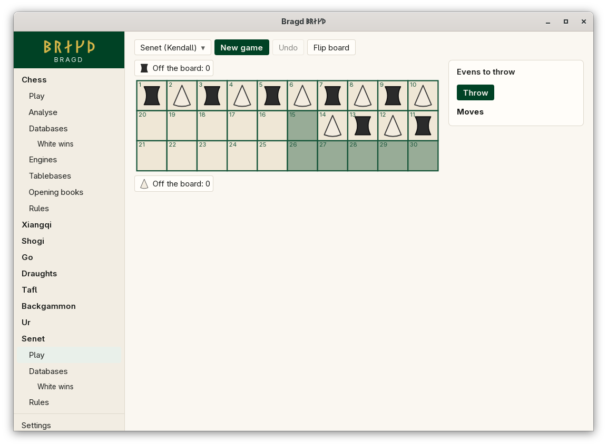

[← README](../../README.md) · [Docs index](../README.md) · [Play](README.md)

# Senet

The Egyptian race game, as Timothy Kendall reconstructed it. Thirty houses in three rows are walked as a snake. Each Side starts with seven pieces on the board and races them off the end. Nothing is captured: landing on a lone enemy swaps the two pieces. The last houses carry special rules, and house 27 is the water. Bragd throws the four sticks for you.

*Senet: the opening position, Evens and Odds alternating along the first row.*

| Variant | Key | Sides |
|---|---|---|
| Senet | `senet` | Evens (moves first), Odds |

## How to reach it

Sidebar → **Senet** → **Play**. Senet has only **Play**, **Databases** and **Rules** in the sidebar, because it has no Engine.

## What it needs

Nothing. Senet has no outside Engine, and Bragd's built-in Bot for it is not built yet, so you can only play against yourself.

## Controls

| What you want | What you do |
|---|---|
| Throw | **Throw**, under the turn line. *Thrown: n* shows the count, 1 to 5 |
| Move a piece | Click it, then the house the throw reaches; or drag it |
| Bear off | Click the piece, then your *Off the board* tray, which is marked when bearing off is legal |
| Or pick the move | Click it under *Legal moves*. Every legal move for the throw is listed |

A throw with no legal move passes the turn by itself. Board colours: [Board themes](../look/board-themes.md).

## The special houses

| House | Rule |
|---|---|
| 15 | House of Rebirth: where a drowned piece comes back |
| 26 | House of Beauty: every piece must stop here before going on |
| 27 | The water: landing here ends the turn, and no other piece of yours moves until this one is out. Each turn after the throw, rescue it to house 15 (when 15 is empty), or bear it off on an exact 4 |
| 28 | Leaves the board on a throw of exactly 3 |
| 29 | Leaves the board on a throw of exactly 2 |
| 30 | Leaves the board on any throw |

## Settings and config.toml

| Setting | `config.toml` key | Default | What it does |
|---|---|---|---|
| The Family on or off | `families.family` | On | `senet = false` under `[families.family]` hides it |

## Questions

#### How are the sticks thrown?

Four two-faced sticks. The throw is the count of marked faces up, 1 to 4, and none up counts 5. There is no 0.

#### When do I throw again?

After a throw of 1, 4 or 5, once you have moved. A 2 or a 3 ends the turn. A piece falling into the water ends it too.

#### Why can I not land on that piece?

An enemy piece with another of its own on a next house is protected. You may land only on an empty house or a lone enemy, which then swaps places with your piece.

#### Why did my piece move backwards?

When no forward move is legal, a backward move must be played. If neither is legal, the turn passes.

#### Why can my piece not get past house 26?

Every piece must land exactly on 26 before it goes further. A piece standing on 26 blocks everything behind it, your own pieces too.

#### Why does senet differ from the rules I know?

Every senet ruleset is a reconstruction. Bragd plays Kendall's and names every point where sources disagree in [Ur and senet](../rules/ur-and-senet-rules.md).

---
[← Previous: Ur](ur.md) · [Next: Knowledge →](../knowledge/README.md)
