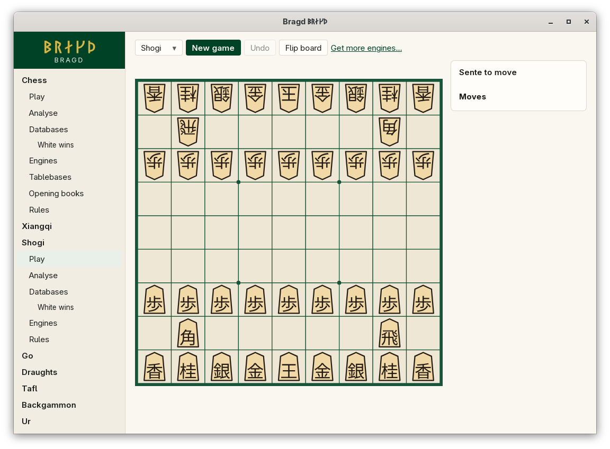

[← README](../../README.md) · [Docs index](../README.md) · [Play](README.md)

# Shogi

Japanese chess on a 9×9 board. A captured piece changes sides and waits in its captor's hand, to be dropped back onto the board later. The pieces are wedges with kanji drawn as outlines, and each points at its owner.

*Shogi: each Side's hand is a tray beside its edge of the board.*

| Variant | Key | Sides | Board |
|---|---|---|---|
| Shogi | `shogi` | Sente (moves first), Gote | 9×9 |

## How to reach it

Sidebar → **Shogi** → **Play**. With only shogi on, **Play** is at the top of the sidebar.

## What it needs

Nothing to play against yourself. Against an Engine: Fairy-Stockfish or YaneuraOu installed. Both are spoken to in USI ([Playing against an Engine](against-an-engine.md)).

## Controls

| What you want | What you do |
|---|---|
| Move | Click the piece, then the target; or drag it |
| Drop a piece from hand | Click it in your tray (it shows how many you hold), then click an empty square it may go to |
| Promote | Move into, inside or out of the far three ranks. When promotion is optional, *Which move?* offers both: the move ending in `+` promotes. When it is forced, it happens at once |
| Turn the board | **Flip board**. The pieces turn with it, so each still points at its owner |

The move list is in USI notation: `7g7f`, a promotion `8h2b+`, a drop `P*5e`. Board colours: [Board themes](../look/board-themes.md).

## Settings and config.toml

| Setting | `config.toml` key | Default | What it does |
|---|---|---|---|
| The Family on or off | `families.family` | On | `shogi = false` under `[families.family]` hides it |
| Default Engine | `engines.default` | First installed | Such as `shogi = "yaneuraou"` |

## Questions

#### Why can I not drop a pawn on this file?

The rules forbid it: a Side may not have two unpromoted pawns on one file, and a pawn may not be dropped to give checkmate. A drop the rules forbid is not offered, so clicking that square does nothing.

#### Why is the move list not in Western notation?

USI is the form Bragd stores and engines speak. A display notation on top of it is not built yet.

#### Can I play a handicap Game?

Not yet. Handicap starts are a New game choice that is not offered. See [Shogi](../rules/shogi.md).

#### What happens when both kings reach the far side?

The impasse rule (jishogi) is not built. Such a Game runs to the move limit and is drawn.

#### Why does a piece in hand show a number?

The tray shows each kind once, with how many you hold. A greyed button means you hold none of that kind.

---
[← Previous: Xiangqi and janggi](xiangqi.md) · [Next: Go →](go.md)
