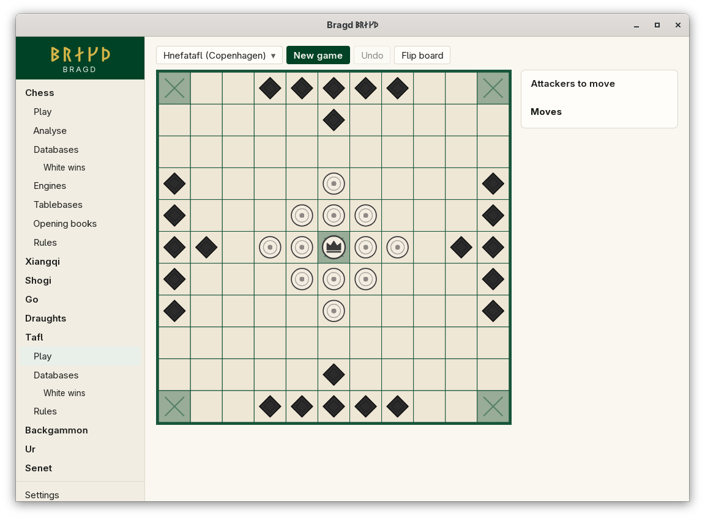
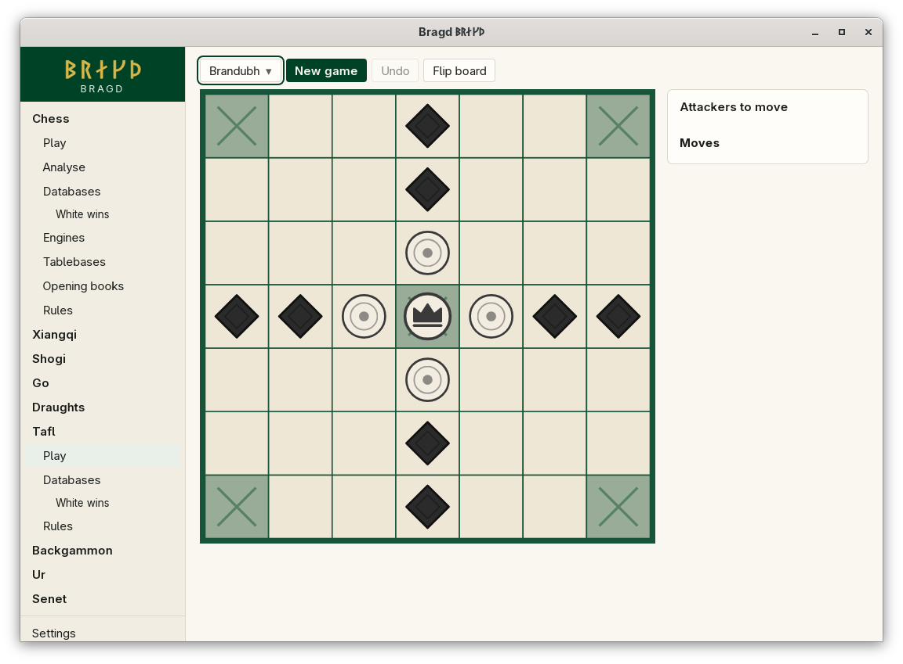

[← README](../../README.md) · [Docs index](../README.md) · [Play](README.md)

# Tafl

The Viking board games. The Defenders start in the middle around their king; the Attackers start on the edges. The Defenders win when the king reaches a corner. The Attackers win when they capture him. Every piece moves like a chess rook, and a piece is captured when two enemies close it in on opposite sides. The Attackers move first.

*Hnefatafl (Copenhagen), 11×11.*

*Brandubh, 7×7.*

| Variant | Key | Board | Ruleset |
|---|---|---|---|
| Hnefatafl (Copenhagen) | `hnefatafl` | 11×11 | Copenhagen rules: shieldwall, exit fort, repetition ban |
| Hnefatafl (Fetlar) | `hnefatafl-fetlar` | 11×11 | Copenhagen without the shieldwall, the exit fort and the repetition ban |
| Tablut | `tablut` | 9×9 | Linnaeus, 1732, with the corner escape |
| Brandubh | `brandubh` | 7×7 | The Irish game; the king is armed |

Tafl has no standard rules: every modern ruleset is a reconstruction. Bragd names the reading it plays for each Variant on [Tafl sizes](../rules/tafl-sizes.md).

## How to reach it

Sidebar → **Tafl** → **Play**, then choose the Variant in the first list of the bar. Tafl has only **Play**, **Databases** and **Rules** in the sidebar, because it has no Engine.

## What it needs

Nothing. Tafl has no outside Engine, and Bragd's built-in Bot for it is not built yet, so you can only play against yourself.

## Controls

| What you want | What you do |
|---|---|
| Move | Click the piece, then a square along its row or column; or drag it |
| Capture | Move so that an enemy piece is closed in between your piece and another of yours, or a hostile square (a corner, the empty throne) |
| Escape with the king | Move the king onto a corner square |

Only the king may stop on the throne and the corners. Board colours: [Board themes](../look/board-themes.md).

## Settings and config.toml

| Setting | `config.toml` key | Default | What it does |
|---|---|---|---|
| The Family on or off | `families.family` | On | `tafl = false` under `[families.family]` hides it |
| A Variant on or off | `families.variant` | All on | `tablut = false` under `[families.variant]` hides tablut |

## Questions

#### Why can I not play against the computer?

Tafl has no outside Engine, and Bragd's own Bot for it is not built yet.

#### Why was my piece taken next to a corner?

A corner counts as an enemy for capture, for both Sides. A piece beside a corner is taken by one enemy on its other side. This catches many players in brandubh.

#### Why does the tablut king have to reach a corner, not the edge?

Linnaeus's account is unclear on this. Under the edge reading the Defenders win nearly every Game, so Bragd plays the corner escape. See [Tafl sizes](../rules/tafl-sizes.md).

#### What is the shieldwall?

A Copenhagen rule: a row of pieces along the edge, closed in at both ends, is captured all at once. Fetlar, tablut and brandubh do not have it.

#### Why are the Attackers first?

The Attackers are the first Side in every tafl Variant here, and the first Side moves first.

---
[← Previous: Draughts](draughts.md) · [Next: Backgammon →](backgammon.md)
