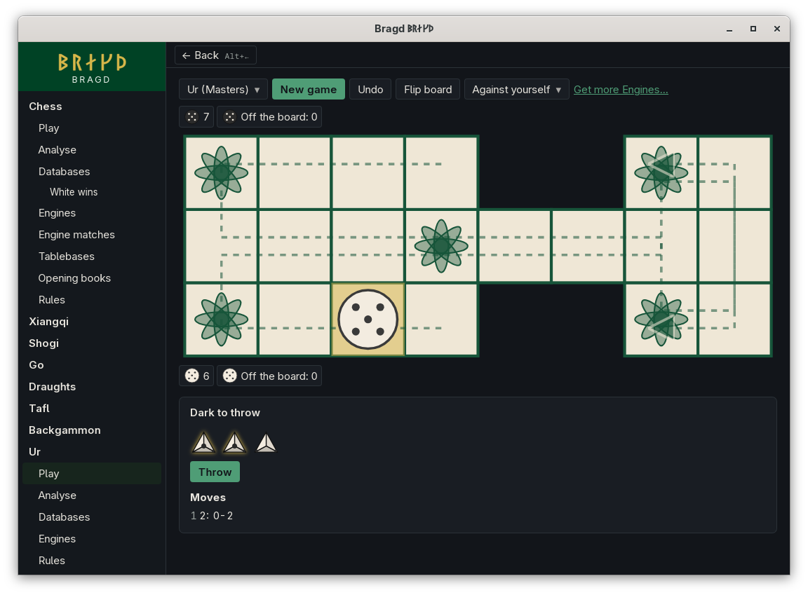
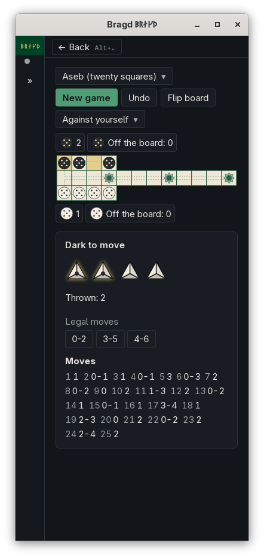
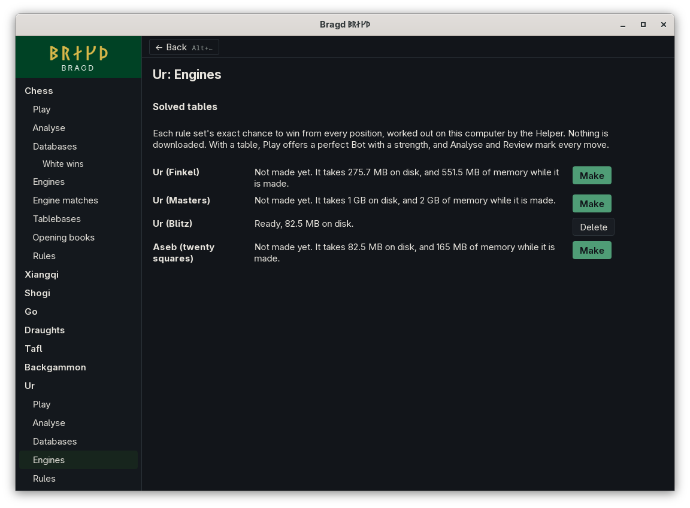
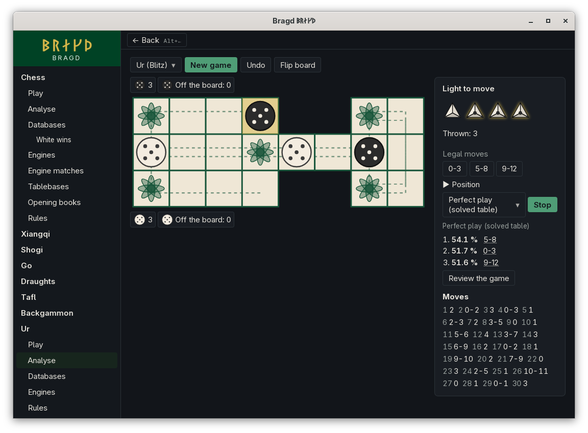
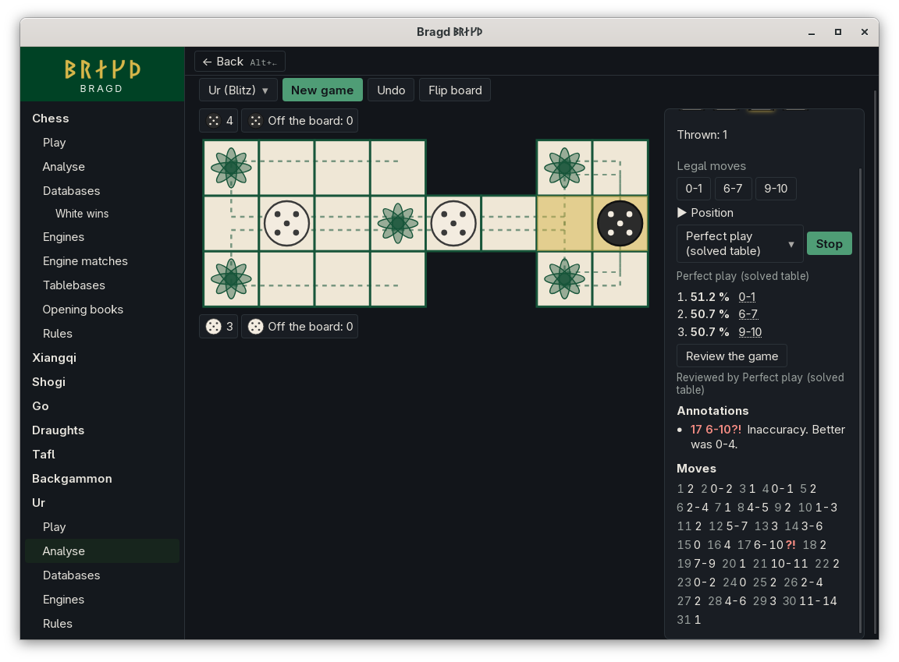

[← README](../../README.md) · [Docs index](../README.md) · [Play](README.md)

# Ur

The Royal Game of Ur, in four rule sets: Irving Finkel's reconstruction, James Masters', RoyalUr.net's Blitz, and Aseb on its own board of twenty squares. Each Side races its pieces along a path and off the board. Squares both Sides walk are shared, and landing on an enemy piece there sends it back to the start. Bragd throws the pyramid dice for you and shows how each one landed.

*The Royal Game of Ur: Light at the bottom, Dark at the top.*

| Variant | Key | Pieces | Dice | Path | Sides |
|---|---|---|---|---|---|
| Ur (Finkel) | `ur` | 7 | 4 | 14 squares | Light (moves first), Dark |
| Ur (Masters) | `ur-masters` | 7 | 3, and 0 moves four | 16 squares | Light, Dark |
| Ur (Blitz) | `ur-blitz` | 5 | 4 | 16 squares | Light, Dark |
| Aseb (twenty squares) | `ur-aseb` | 5 | 4 | 16 squares | Light, Dark |

Each rule set, its path and its sources: [Ur rule sets](../rules/ur.md). The board draws both Sides' paths as dashed lines, each ending in an arrow.

*Masters' rules: three dice, and a path of sixteen squares through the far end.*

*Aseb on its own board of twenty squares. Blitz: [1100 px](../screenshots/play-ur-blitz-1100.png), [390 px](../screenshots/play-ur-blitz-390.png).*

## How to reach it

Sidebar → **Ur** → **Play**, then pick the rule set under **Variant**. Ur has no outside Engine, so its sidebar has no **Engine matches**. Its **Engines** page makes the [solved tables](#the-solved-tables), and **Analyse** reads them.

## What it needs

Nothing. Ur has no outside Engine. Bragd's own Bot plays every Ur rule set: set **Opponent** to *Against an Engine* and pick *Bragd's Bot* under **Engine**. For perfect play and marked moves, make the rule set's [solved table](#the-solved-tables) first.

## The solved tables

Every Ur rule set Bragd plays is solved (F1 → Features: `ur_solved`): Bragd works out the exact chance to win of every position, for the side about to throw, if both sides play perfectly from there. The table is made on your computer by the Helper, so nothing is downloaded. How it is worked out, and how it was checked against the published values: [Ur rule sets](../rules/ur.md#solved).

*Ur's solved tables, Blitz made. At phone width: [390 px](../screenshots/ur-tables-390.png).*

Sidebar → **Ur** → **Engines** lists one table for each Ur Variant that is on, with its size on disk and the memory it takes while it is made. **Make** queues the job, which shows its progress there and on the Jobs page. **Cancel** stops it, and nothing is written. **Delete** removes a table.

| Rule set | Positions | On disk | Memory while made |
|---|---|---|---|
| Finkel | 137,870,097 | 275.7 MB | 551.5 MB |
| Masters | 500,929,993 | 1 GB | 2 GB |
| Blitz | 41,243,781 | 82.5 MB | 165 MB |
| Aseb | 41,243,781 | 82.5 MB | 165 MB |

With a table, the rule set gets *Perfect play (solved table)* as an Engine:

| Where | What it does |
|---|---|
| Play | **Opponent** → *Against an Engine*, **Engine** → *Perfect play*. **Strength** 20 always plays the best move. Lower, it sometimes plays a weaker move, the less often the more it gives away |
| Analyse | Before a throw: the chance to win of the side to throw. After a throw: each move with the chance it keeps, best first. The last move's mark shows under them |
| Review | **Review** in Analyse marks each move by the chance to win it gave away against the best move for the same throw: 2 percentage points or more is `?!`, 5 is `?`, 10 is `??`. The best move is `!` when the next best gave 5 points away, and `!!` at 10. The better move is named |

*Analyse after a throw: each move and the chance it keeps. At phone width: [390 px](../screenshots/analyse-ur-390.png).*

*Review the game, from the table. At phone width: [390 px](../screenshots/review-ur-390.png).*

Chances are shown from Light's view, like every evaluation in Bragd. The chances before each throw and the moves' Annotations go into the [Position store](../knowledge/position-store.md), keyed by the position: the throw belongs to the turn, as in backgammon.

## Controls

| What you want | What you do |
|---|---|
| Throw | **Throw**, under the turn line. The pyramid dice tumble in, a marked tip up glows, and *Thrown: n* shows the steps |
| Play against Bragd's Bot | **Opponent** → *Against an Engine*, **Engine** → *Bragd's Bot*, and pick the Side it plays |
| Play against perfect play | Make the [solved table](#the-solved-tables), then **Engine** → *Perfect play* and set **Strength** |
| See each move's chance to win | Sidebar → **Ur** → **Analyse**, with *Perfect play* as the Engine |
| Enter a piece | Click your tray of waiting pieces, then the square the throw reaches |
| Move a piece | Click it, then the square the throw reaches; or drag it |
| Bear off | Click the piece, then your *Off the board* tray, which is marked when bearing off is legal |
| Or pick the move | Click it under *Legal moves*. Every legal move for the throw is listed |

A throw with no legal move passes the turn by itself, and *No move with n* says so. *Moves* lists one entry a turn: its number, the throw and the move, such as `3 2: 5-7`. A throw that allowed no move is written with a dash, `4 0: –`. Each Side's path is dashed on the board, with an arrow on the last square. On a window narrower than 760 px, Aseb's board, twelve squares long, lies on its side so its squares are big enough to click. A throw with one legal move plays it by itself after a short pause ([Forced moves](against-yourself.md#forced-moves)). Board colours: [Board themes](../look/board-themes.md).

## Settings and config.toml

| Setting | `config.toml` key | Default | What it does |
|---|---|---|---|
| The Family on or off | `families.family` | On | `ur = false` under `[families.family]` hides it |
| A rule set on or off | `families.variant` | On | `"ur-blitz" = false` under `[families.variant]` hides Blitz from Play and New game |
| Play forced moves by themselves | `play.forced` | On | A throw that leaves one legal move plays it by itself |

## Questions

#### How are the dice thrown?

Tetrahedral dice, each with two marked tips of four. The throw is the number of dice that land with a marked tip up: 0 to 4 with four dice, and 2 is the most likely throw. Masters' rules throw three dice, and a 0 moves four. Each die on screen shows whether its marked tip is up. The record keeps only the count, so which dice show it is a fixed spread.

#### What do the rosettes do?

Landing on a rosette gives you another throw at once, and this can chain. In Finkel's rules the rosette in the middle of the shared row is safe: a piece on it cannot be taken, and the other Side cannot land there. Aseb keeps its three shared rosettes safe. Masters and Blitz have no safe square, and in Blitz a capture also earns another throw.

#### Why can I not bear this piece off?

Bearing off needs the exact throw: one more than the squares left on the path. A larger throw cannot be spent on that piece.

#### Why can I not land on my own piece?

A square holds one piece. A move onto your own piece is not legal, so it is not offered.

#### Why does Ur differ from the rules I know?

Every Ur rule set is a reconstruction. Bragd plays four, cites the source of each and says which it left out in [Ur rule sets](../rules/ur.md). The points where sources disagree on Finkel's are in [Ur and senet](../rules/ur-and-senet-rules.md).

#### How does Bragd's Bot choose?

It looks one throw ahead: for each move it weighs every next throw by how likely it is and expects the best reply. It plays the same move for the same position and throw. *Perfect play* reads the solved table instead.

#### How long does making a table take?

Minutes on a desktop computer, and longer on a laptop: it uses every core. On a computer with 32 threads Blitz took about a minute and a quarter, Finkel a few minutes, and Masters, with three and a half times as many positions as Finkel, under half an hour. Masters needs 2 GB of memory while it is made. The work is counted, not timed, in [Ur rule sets](../rules/ur.md#solved).

#### Why are Ur's marks given in percentage points?

The table gives the exact chance to win, so a move is judged by how much of it the move threw away, as go's moves are, but with smaller amounts: an Ur game is short and its table exact, so go's 5, 10 and 20 points would rarely mark a move. A move can be the right one and still lose, because the dice decide the rest.

---
[← Previous: Backgammon](backgammon.md) · [Next: Senet →](senet.md)
