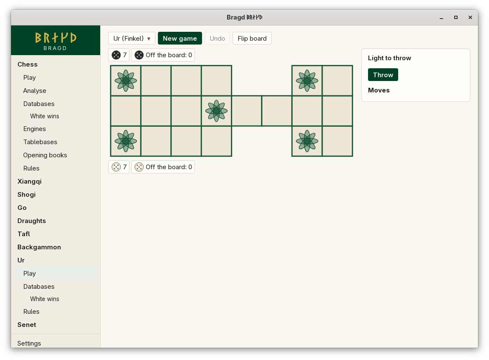

[← README](../../README.md) · [Docs index](../README.md) · [Play](README.md)

# Ur

The Royal Game of Ur, as Irving Finkel reconstructed it. Each Side races seven pieces along a path of fourteen squares and off the board. The middle row is shared, and landing on an enemy piece there sends it back to the start. Bragd throws the four dice for you.

*The Royal Game of Ur: Light at the bottom, Dark at the top.*

| Variant | Key | Sides |
|---|---|---|
| The Royal Game of Ur | `ur` | Light (moves first), Dark |

## How to reach it

Sidebar → **Ur** → **Play**. Ur has only **Play**, **Databases** and **Rules** in the sidebar, because it has no Engine.

## What it needs

Nothing. Ur has no outside Engine, and Bragd's built-in Bot for it is not built yet, so you can only play against yourself.

## Controls

| What you want | What you do |
|---|---|
| Throw | **Throw**, under the turn line. *Thrown: n* shows the count, 0 to 4 |
| Enter a piece | Click your tray of waiting pieces, then the square the throw reaches |
| Move a piece | Click it, then the square the throw reaches; or drag it |
| Bear off | Click the piece, then your *Off the board* tray, which is marked when bearing off is legal |
| Or pick the move | Click it under *Legal moves*. Every legal move for the throw is listed |

A throw of 0, or a throw with no legal move, passes the turn by itself. Board colours: [Board themes](../look/board-themes.md).

## Settings and config.toml

| Setting | `config.toml` key | Default | What it does |
|---|---|---|---|
| The Family on or off | `families.family` | On | `ur = false` under `[families.family]` hides it |

## Questions

#### How are the dice thrown?

Four tetrahedral dice, each with two marked tips of four. The throw is the number of marked tips up, 0 to 4. A 2 is the most likely throw.

#### What do the rosettes do?

Landing on a rosette gives you another throw at once, and this can chain. The rosette in the middle of the shared row is safe: a piece on it cannot be taken, and the other Side cannot land there.

#### Why can I not bear this piece off?

Bearing off needs the exact throw: one more than the squares left on the path. A larger throw cannot be spent on that piece.

#### Why can I not land on my own piece?

A square holds one piece. A move onto your own piece is not legal, so it is not offered.

#### Why does Ur differ from the rules I know?

Every Ur ruleset is a reconstruction. Bragd plays Finkel's and names every point where sources disagree in [Ur and senet](../rules/ur-and-senet-rules.md).

---
[← Previous: Backgammon](backgammon.md) · [Next: Senet →](senet.md)
