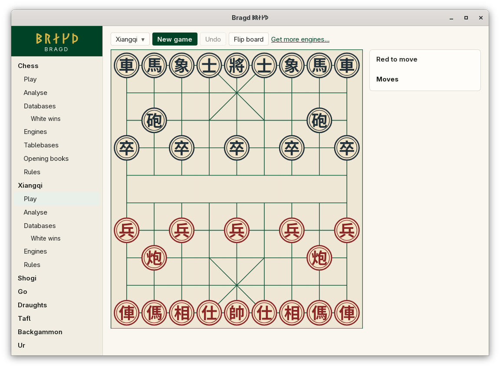
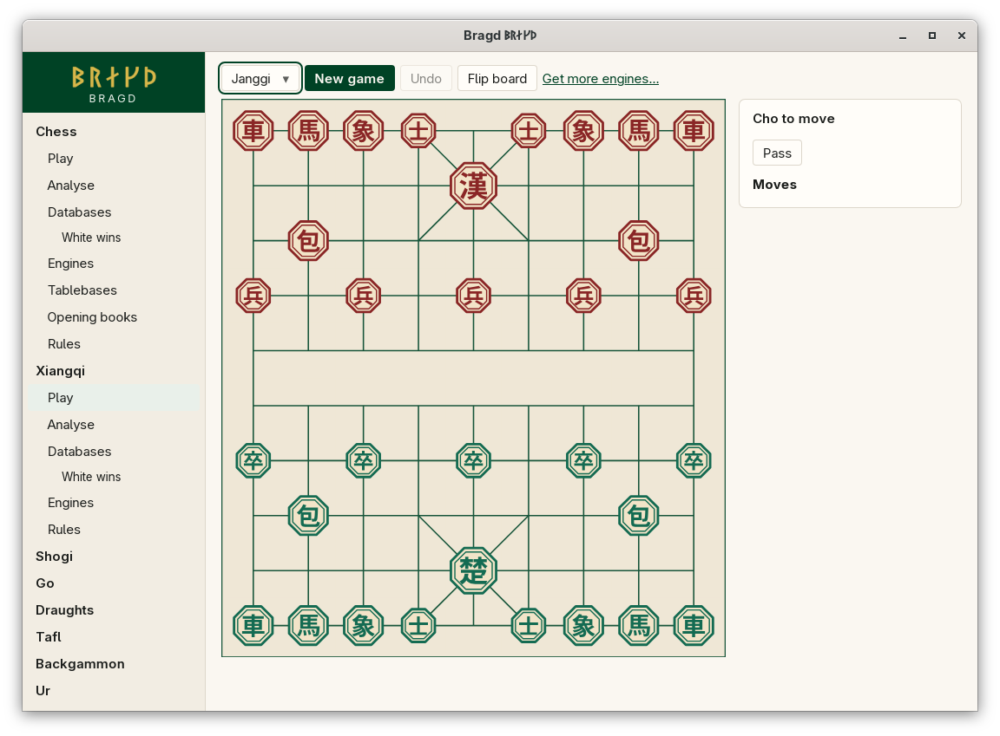

[← README](../../README.md) · [Docs index](../README.md) · [Play](README.md)

# Xiangqi and janggi

The Xiangqi Family holds two Variants on the same 9×10 board of intersections: xiangqi, Chinese chess, and janggi, Korean chess. Pieces stand on the points, not in the squares. The glyphs are outlines drawn from Noto Sans CJK, so they need no font on your machine.

*Xiangqi: the river across the middle, a palace on each side.*

*Janggi: Cho (green) at the bottom, Han (red) at the top.*

| Variant | Key | Sides | What is different |
|---|---|---|---|
| Xiangqi | `xiangqi` | Red, Black | The river; the generals may not face each other |
| Janggi | `janggi` | Cho, Han | No river; a player may pass; facing generals (bikjang) is a draw |

## How to reach it

Sidebar → **Xiangqi** → **Play**, then choose the Variant in the first list of the bar. Analyse, Databases, Engines and Rules are in the sidebar too.

## What it needs

Nothing to play against yourself. Against an Engine: Fairy-Stockfish (xiangqi and janggi) or Pikafish (xiangqi) installed ([Playing against an Engine](against-an-engine.md)).

## Controls

| What you want | What you do |
|---|---|
| Move | Click the piece, then the point it goes to; or drag it |
| Pass (janggi) | **Pass**, under the turn line. It shows only when a pass is legal |
| See the last move | Its two points are marked on the board |

Board colours: [Board themes](../look/board-themes.md).

## Settings and config.toml

| Setting | `config.toml` key | Default | What it does |
|---|---|---|---|
| The Family on or off | `families.family` | On | `xiangqi = false` under `[families.family]` hides both Variants |
| A Variant on or off | `families.variant` | All on | `janggi = false` under `[families.variant]` hides janggi only |
| Default Engine | `engines.default` | First installed | Per Variant, such as `xiangqi = "pikafish"` |

## Questions

#### Why can I not play a move that repeats the position for ever?

You can, but a repetition is judged. A Side that gave check with every move of the repeated cycle loses (perpetual check). Any other threefold repetition is a draw. The perpetual-chase rules are not built yet, so a chase is scored as a draw too. See [Xiangqi](../rules/xiangqi.md).

#### Why did I lose with no move left and no check?

In xiangqi, a Side with no legal move loses, stalemate included. That is unlike chess.

#### Can I choose janggi's starting setup?

Not yet. Each Side may swap its horses and elephants before play, which gives sixteen arrangements. The rules crate has them, but New game always starts from the same one. See [Janggi](../rules/janggi.md).

#### Why is there a Pass button in janggi?

A janggi player not in check may always pass. That is also why janggi has no stalemate.

#### How does a janggi Game end when it runs out?

It is decided by counting material, not halved. Han's 1.5-point handicap makes a tie impossible.

#### Why do the pieces not turn round when I flip the board?

Xiangqi and janggi pieces are discs and octagons that read the same from both sides. Shogi pieces do turn, because they point at their owner.

---
[← Previous: Chess and its Variants](chess.md) · [Next: Shogi →](shogi.md)
