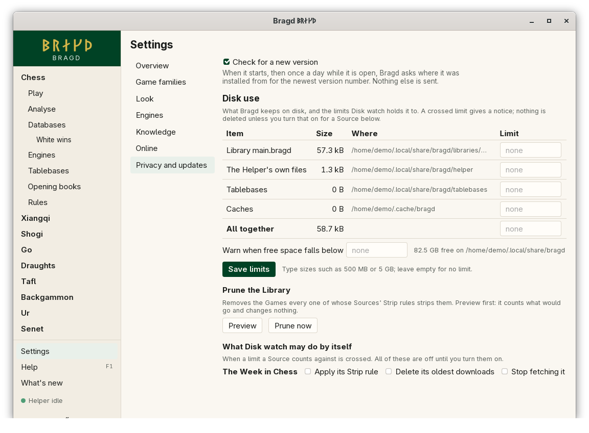

[← README](../../README.md) · [Docs index](../README.md) · [Reference](README.md)

# Every setting

Settings has seven areas: Overview, Game families, Look, Engines, Knowledge, Online, and Privacy and updates. Each item is saved to `config.toml` the moment you change it. This page lists every item by area, with the name the app gives it and the key it writes.

*Settings at Overview.*

*Settings at Privacy and updates.*

## Contents

- [How to reach it](#how-to-reach-it)
- [Overview](#overview)
- [Game families](#game-families)
- [Look](#look)
- [Engines](#engines)
- [Knowledge](#knowledge)
- [Online](#online)
- [Privacy and updates](#privacy-and-updates)
- [Questions](#questions)

## How to reach it

| Where | What to do |
|---|---|
| Sidebar | **Settings**, always at the bottom |
| Install wizard | Each step names its Settings area, and its link opens it |
| Keys | **Tab** moves through the areas and items |

## Overview

| Button | What it does |
|---|---|
| Run the install wizard again | Opens the [install wizard](../getting-started/first-start.md) |
| Open config.toml | Opens [`config.toml`](config-toml.md) in your system's editor |
| Suggest a better translation | Opens a new GitHub issue in the browser ([Languages](../look/languages.md)) |

## Game families

One switch per Game family, and under it one per Variant. All are on by default ([Game families and Variants](../getting-started/game-families.md)). A switch's name is `family_<key>` or `variant_<key>`, and it writes `families.family.<key>` or `families.variant.<key>`.

| Family switch | Variant switches |
|---|---|
| `family_chess` | `variant_chess`, `variant_chess960`, `variant_shatranj`, `variant_chaturanga`, `variant_kingofthehill`, `variant_racingkings`, `variant_seirawan`, `variant_capablanca` |
| `family_xiangqi` | `variant_xiangqi`, `variant_janggi` |
| `family_shogi` | `variant_shogi` |
| `family_go` | `variant_go-9`, `variant_go-13`, `variant_go-19` |
| `family_draughts` | `variant_checkers`, `variant_draughts`, `variant_draughts-brazilian`, `variant_draughts-russian` |
| `family_tafl` | `variant_hnefatafl`, `variant_hnefatafl-fetlar`, `variant_tablut`, `variant_brandubh` |
| `family_backgammon` | `variant_backgammon` |
| `family_ur` | `variant_ur` |
| `family_senet` | `variant_senet` |

## Look

| Name | Shown as | `config.toml` key | What it does |
|---|---|---|---|
| `language` | Language | `language` | Automatic follows your system's language, or the nearest one Bragd has |
| `theme` | Theme | `look.theme` | The app's colours, and with some Themes their own shapes. Racing green is the default |
| `look` | Look | `look.look` | The shapes and chrome laid over the Theme's colours. Empty: the Theme's own |
| `board_theme` | Board theme | `look.board_theme` | The four colours of every board. Match theme takes them from the Theme |
| `file_picker` | File picker | `look.file_picker` | The dialog that opens and saves files: Automatic (Coxswain's picker when found, else the system's), Coxswain or the system's ([File picker](../look/file-picker.md)) |

## Engines

| Name | Shown as | `config.toml` key | What it does |
|---|---|---|---|
| `engines_containers` | Pull an Engine that is not installed | `engines.containers` | Runs it from a sealed container image with podman or docker, with no network |
| `engines_runtime` | Container runtime | `engines.runtime` | Automatic uses podman, else docker |

The Engine per Variant, added Engines and their options are on each Family's [Engines page](../engines/engines.md).

## Knowledge

| Name | Shown as | `config.toml` key | What it does |
|---|---|---|---|
| `library` | Library folder | `knowledge.library` | Where your Libraries are kept. Empty: Bragd's data folder |
| `source_priority` | Source priority | `knowledge.source_priority` | When Duplicates merge, a header conflict goes the way of the Source listed first. Typed as a list with commas |
| `max_unpack_ratio` | Largest unpacking ratio | `knowledge.max_unpack_ratio` | How many times its own size a packed game file may unpack to before an import, or reading it as a Foreign database, stops. `50` unless set ([Sources](../knowledge/sources.md#why-did-an-import-stop-saying-the-file-unpacks-too-far)) |
| `tablebases_path` | Tablebase folder | `tablebases.path` | Your Syzygy tables. The folder is passed to every Engine |
| `start_with_session` | Start with my session | `helper.start_with_session` | The Helper keeps fetching and indexing while no window is open |

## Online

| Name | Shown as | `config.toml` key | What it does |
|---|---|---|---|
| `tablebases_online` | Ask Lichess for tablebase positions | `tablebases.online` | When your tables do not cover a position, that position is sent to the Lichess tablebase API |

Signing in to servers comes later ([Playing online](../online/playing-online.md)).

## Privacy and updates

| Name | Shown as | `config.toml` key | What it does |
|---|---|---|---|
| `check_updates` | Check for a new version | `updates.check` | At start, then once a day, Bragd asks where it was installed from for the newest version number |
| `disk_total` | Disk limit for all Bragd keeps | `disk.total` | In bytes, 0 is no limit. Set on the Disk use page below |
| `disk_free_below` | Warn below this much free space | `disk.free_below` | In bytes, 0 is no warning. Set on the Disk use page below |

The Disk use page is part of this area. It also sets each item's own limit, `disk.items` ([Disk watch](../knowledge/disk-watch.md)).

## Questions

#### Do I need to press Save?

No. Each item is written to `config.toml` the moment you change it, and the window takes the change at once.

#### Why can I not find the Engine for each Variant in Settings?

It belongs to the Family, so it is on that Family's Engines page, as are added Engines and their options.

#### What happens to my comments in config.toml when I change a setting?

They stay. Only the one key is changed, in place.

#### Can I type a size such as 5 GB?

On the Disk use page, yes: it reads `5 GB` or `500 MB`, in powers of 1000. In `config.toml` the value is in bytes.

#### Why are some settings missing from the Settings window?

Some keys have their own page: the Engine per Variant, opening books and disk item limits. Your own Themes are set only in `config.toml` (`themes`). Every key is in [config.toml](config-toml.md).

---
[← Previous: config.toml](config-toml.md) · [Next: Command line →](command-line.md)
